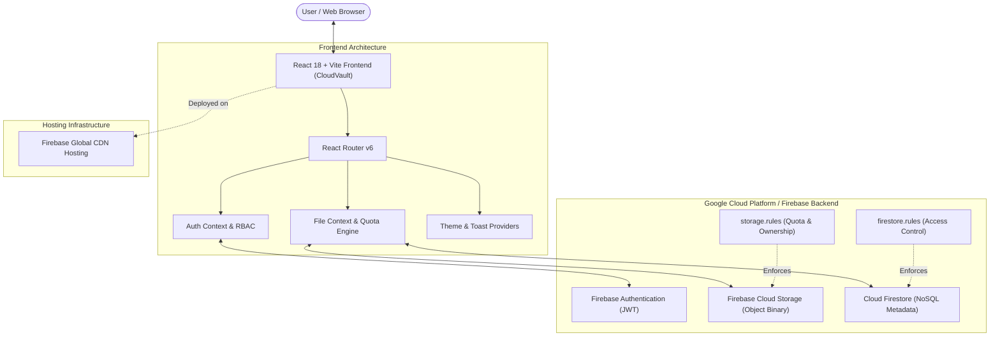

# ☁️ CloudVault — Cloud-Based File Storage and Sharing System

> **College Cloud Computing Mini Project**  
> Developed using React.js, Tailwind CSS, Lucide Icons, and Google Cloud Firebase Backend (Firebase Auth, Cloud Firestore, Cloud Storage, Security Rules, and Hosting).

---

## 📋 Table of Contents
1. [Project Abstract](#1-project-abstract)
2. [Key Features & Modules](#2-key-features--modules)
3. [System Architecture](#3-system-architecture)
4. [Technology Stack](#4-technology-stack)
5. [Cloud Database Design (Cloud Firestore)](#5-cloud-database-design-cloud-firestore)
6. [Cloud Security Rules (Firestore & Storage)](#6-cloud-security-rules-firestore--storage)
7. [Installation & Local Setup](#7-installation--local-setup)
8. [Firebase Setup & Configuration Guide](#8-firebase-setup--configuration-guide)
9. [Deployment Instructions (Firebase Hosting)](#9-deployment-instructions-firebase-hosting)
10. [Testing & Verification Guide](#10-testing--verification-guide)
11. [College Viva Voce Q&A Preparation](#11-college-viva-voce-qa-preparation)
12. [Project Screenshots & UI Guide](#12-project-screenshots--ui-guide)

---

## 1. Project Abstract

**CloudVault** is a full-stack, distributed web-based cloud file storage and file-sharing platform designed and built as a college Cloud Computing mini project. Inspired by Google Drive and Dropbox, CloudVault allows users to securely upload, manage, search, preview, download, and share files across the internet.

Traditional local file storage suffers from single-point-of-failure vulnerabilities, lack of remote access, and cumbersome collaboration. CloudVault leverages **Google Cloud Platform (GCP)** through **Firebase Services** to provide:
- High availability object storage with chunked resumable uploads.
- Real-time NoSQL metadata persistence using **Cloud Firestore**.
- Cryptographically signed user authentication with role-based access control (RBAC).
- Dynamic fine-grained sharing with viewer/editor permissions and link expirations.
- Two-stage file deletion lifecycle (Soft Trash $\rightarrow$ Permanent Cloud Purge).
- Real-time storage consumption analytics and quota monitoring (5 GB Tier).

---

## 2. Key Features & Modules

### 2.1 Authentication Module
- **User Registration:** Email, full name, and password with validation.
- **Secure Authentication:** Firebase Email/Password Auth tokens (JWT).
- **Password Reset:** Automatic dispatch of Firebase password recovery emails.
- **Profile Management:** Update display name, customize avatar URL, change password.
- **Evaluation Quick Sign-In:** 1-click demo login buttons for **Admin** and **Student** accounts to facilitate immediate college viva assessment.

### 2.2 Dashboard Module
- Live dashboard displaying real database telemetry:
  - Total uploaded objects.
  - Storage space consumed vs. total quota (5 GB).
  - Available storage capacity.
  - Active shared files count.
  - Storage usage percentage bar with multi-category distribution.
  - Recent uploads carousel.
  - Real-time activity audit stream.

### 2.3 Cloud File Upload Module
- **Drag-and-Drop:** Intuitive upload zone with visual drag state feedback.
- **Multiple Files:** Concurrent staging and chunked upload of batch files.
- **Progress Tracking:** Real-time upload percentage (0% to 100%) calculated via Firebase `uploadBytesResumable`.
- **Validation:** Enforces maximum file size limit (100 MB) and validates allowed MIME types.
- **Format Support:** PDF, DOC, DOCX, XLS, XLSX, PPT, PPTX, JPG, PNG, GIF, MP4, MP3, TXT, ZIP, Code files (JS, TS, PY, HTML, CSS, JSON).

### 2.4 File Management Module
- **Dual View Modes:** Seamless toggle between **Grid View** (visual cards) and **Table View** (compact list).
- **Search & Filter:** Instant search by name; categorized filter tabs (All, Documents, Images, Videos, Archives, Code).
- **Sorting:** Sort by upload date (newest/oldest), file name (A-Z/Z-A), or file size (largest/smallest).
- **Context Actions:** Preview, Download, Share, Rename, View Metadata Details, and Move to Trash.

### 2.5 Multi-Format File Preview Modal
- **PDF Documents:** Embedded responsive reader.
- **Images:** High-resolution zoomable viewer.
- **Videos:** Native HTML5 streaming player with seek controls.
- **Audio:** Built-in audio player for MP3, WAV, OGG.
- **Code & Text:** Syntax preview for TXT, JSON, CSV, JS, PY, HTML.

### 2.6 Secure File Sharing Module
- **Direct Email Sharing:** Share files with specific registered user emails.
- **Shareable Link Generation:** Unique `/share/:shareId` routing tokens.
- **Granular Permissions:** Grant `Viewer` (read/download) or `Editor` (modify/rename) access.
- **Link Expiration:** Optional auto-expiry (1 day, 7 days, 30 days, or permanent).
- **Revocation:** Owners can revoke sharing permissions at any moment.
- **Authorization Enforcement:** Unauthorized users attempting to open restricted links are blocked and prompted to sign in with the correct account.

### 2.7 Two-Stage Safe Trash
- Moving a file to trash flags `isTrash = true` without deleting the underlying cloud object immediately.
- Users can restore trashed files back into their active workspace.
- Permanent deletion completely removes the binary blob from Firebase Cloud Storage, removes the Firestore document, and decrements the user's storage quota.
- Bulk "Empty Trash" option available.

### 2.8 System Administrator Governance
- Dedicated `/admin` route protected by role-based access control.
- Platform-wide statistics: total registered users, global storage consumed, and total stored objects.
- User management directory: promote users to admin, demote admins, or purge accounts.
- Audit stream monitoring platform actions in real time.

### 2.9 Dark & Light Mode
- Google Drive inspired light theme (crisp white and sky blue accents).
- High-contrast dark theme for low-light lab environments.
- Preference automatically stored in `localStorage`.

---

## 3. System Architecture



### Architectural Highlights:
1. **Separation of Concerns:** The binary file payloads are stored in Cloud Storage buckets, while lightweight metadata is stored in Cloud Firestore. This prevents database bloat and maximizes query performance.
2. **Client-Side Optimization:** Progress events are streamed asynchronously without blocking the user interface.
3. **Resilient Offline/Demo Fallback:** If real Firebase keys are not provided yet in `.env`, the system automatically enters an interactive demonstration mode backed by `localStorage` so the UI never crashes during presentations.

---

## 4. Technology Stack

| Layer | Technology | Purpose |
| :--- | :--- | :--- |
| **Frontend Framework** | React.js 18 | Declarative component-based UI architecture |
| **Build Tool & Bundler** | Vite 5 | Rapid HMR development and optimized production bundles |
| **Styling & Theme** | Tailwind CSS 3 | Google Drive inspired responsive design, dark mode |
| **Icons** | Lucide React | Clean, modern vector icons for file formats and navigation |
| **Routing** | React Router DOM 6 | Client-side routing, protected routes, dynamic share links |
| **Cloud Authentication** | Firebase Auth | User authentication with Email/Password & JWT sessions |
| **Cloud Database** | Cloud Firestore | Real-time NoSQL database for metadata and audit activity |
| **Cloud Object Storage** | Firebase Cloud Storage | Highly available multi-region object storage |
| **Cloud Security** | Firebase Security Rules | Server-side authorization rules for DB and Storage |
| **Cloud Deployment** | Firebase Hosting | Ultra-fast global CDN hosting for static assets |

---

## 5. Cloud Database Design (Cloud Firestore)

### 5.1 `users` Collection
Stores user profiles and quota tracking counters:
```json
{
  "uid": "string (Firebase Auth UID)",
  "name": "string (Full Name)",
  "email": "string (Email address)",
  "role": "string ('user' | 'admin')",
  "storageUsed": "number (Total bytes consumed, e.g. 10485760)",
  "photoURL": "string (Avatar image URL)",
  "createdAt": "timestamp"
}
```

### 5.2 `files` Collection
Stores metadata for all uploaded cloud objects:
```json
{
  "fileId": "string (Unique identifier)",
  "fileName": "string (Original filename, e.g. 'Project_Report.pdf')",
  "fileType": "string (MIME type, e.g. 'application/pdf')",
  "fileSize": "number (File size in bytes)",
  "storagePath": "string ('users/{uid}/files/{timestamp}_{fileName}')",
  "downloadURL": "string (Firebase Storage HTTPS signed URL)",
  "ownerId": "string (Owner UID)",
  "ownerEmail": "string (Owner email)",
  "uploadedAt": "timestamp",
  "isTrash": "boolean (false = active, true = in trash)",
  "trashedAt": "timestamp | null",
  "updatedAt": "timestamp | null"
}
```

### 5.3 `shares` Collection
Stores active file sharing relationships:
```json
{
  "shareId": "string (Unique share link ID)",
  "fileId": "string (Reference to file document)",
  "fileName": "string (Name of the shared file)",
  "fileSize": "number (Size in bytes)",
  "fileType": "string (MIME type)",
  "storagePath": "string (Cloud storage path)",
  "downloadURL": "string (Download URL)",
  "ownerId": "string (UID of user who shared the file)",
  "ownerEmail": "string (Email of file owner)",
  "sharedWithEmail": "string (Target email or '' for public link)",
  "permission": "string ('viewer' | 'editor')",
  "expiresAt": "ISO date string | null",
  "createdAt": "timestamp"
}
```

### 5.4 `activity` Collection
Stores audit trail records:
```json
{
  "activityId": "string (Document ID)",
  "userId": "string (Actor UID)",
  "userEmail": "string (Actor email)",
  "action": "string (e.g. 'Uploaded file', 'Moved to trash', 'Shared file')",
  "fileName": "string (Target file name)",
  "fileId": "string (Target file ID)",
  "timestamp": "timestamp"
}
```

---

## 6. Cloud Security Rules (Firestore & Storage)

### 6.1 Firestore Rules (`firestore.rules`)
- **Authentication Check:** All access requires a valid authenticated user session (`request.auth != null`).
- **Owner Isolation:** Normal users can only read, update, or delete their own documents (`resource.data.ownerId == request.auth.uid`).
- **Shared Access:** Users can read files if the file is shared with their email.
- **Admin Privileges:** Administrators can inspect all users, files, and system audit logs.

### 6.2 Storage Rules (`storage.rules`)
- **Strict Size Limitation:** Enforces that uploaded files cannot exceed 100 MB (`request.resource.size < 100 * 1024 * 1024`).
- **Path Isolation:** Files must be stored under `/users/{userId}/files/{fileName}` where `{userId}` strictly matches `request.auth.uid`.
- **Deny All Unspecified:** Prevents unauthorized writes to any top-level or rogue directories.

---

## 7. Installation & Local Setup

### Prerequisites
- **Node.js:** v18.0.0 or later (tested on Node v22.17.1).
- **npm:** v9.0.0 or later.

### Step 1: Clone or Navigate to the Workspace
```bash
cd d:\chiranjeev
```

### Step 2: Install Project Dependencies
```bash
npm install
```

### Step 3: Configure Environment Variables
Copy `.env.example` to `.env`:
```bash
cp .env.example .env
```
*(If testing without a live Firebase account first, CloudVault will run smoothly in interactive demo mode!)*

### Step 4: Run the Development Server
```bash
npm run dev
```
Open your browser and navigate to:
```
http://localhost:3000
```

---

## 8. Firebase Setup & Configuration Guide

To connect your own live Firebase project to CloudVault:

1. **Create Firebase Project:**
   - Navigate to [Firebase Console](https://console.firebase.google.com/).
   - Click **Add Project** and name it `cloudvault-app`.
   - Disable or enable Google Analytics (optional) and create the project.

2. **Add a Web App:**
   - In Project Overview, click the **Web icon (`</>`)**.
   - Register app nickname (e.g. `cloudvault-web`).
   - Copy the `firebaseConfig` object keys.

3. **Enable Authentication:**
   - In the left sidebar, click **Build $\rightarrow$ Authentication**.
   - Click **Get Started** and enable the **Email/Password** sign-in provider.

4. **Enable Cloud Firestore:**
   - Click **Build $\rightarrow$ Firestore Database**.
   - Click **Create Database**, select your closest server region (e.g. `asia-south1`), and start in **Production Mode**.
   - Deploy `firestore.rules` (see Section 6).

5. **Enable Firebase Cloud Storage:**
   - Click **Build $\rightarrow$ Storage**.
   - Click **Get Started**, choose default security rules, and select a storage bucket region.
   - Deploy `storage.rules`.

6. **Populate `.env`:**
   In your project root, open `.env` and paste your project values:
   ```env
   VITE_FIREBASE_API_KEY=AIzaSy...
   VITE_FIREBASE_AUTH_DOMAIN=cloudvault-app.firebaseapp.com
   VITE_FIREBASE_PROJECT_ID=cloudvault-app
   VITE_FIREBASE_STORAGE_BUCKET=cloudvault-app.appspot.com
   VITE_FIREBASE_MESSAGING_SENDER_ID=1234567890
   VITE_FIREBASE_APP_ID=1:1234567890:web:...
   VITE_ADMIN_EMAIL=admin@cloudvault.com
   ```

---

## 9. Deployment Instructions (Firebase Hosting)

Deploy your application to Google's global CDN:

1. **Install Firebase CLI Globally (if not installed):**
   ```bash
   npm install -g firebase-tools
   ```

2. **Login to Firebase:**
   ```bash
   firebase login
   ```

3. **Build Production Assets:**
   ```bash
   npm run build
   ```
   This generates the optimized bundle in the `dist/` directory.

4. **Deploy Rules and Hosting:**
   ```bash
   firebase deploy
   ```
   Firebase will upload your Firestore rules, Storage rules, and serve your app at:
   `https://<your-project-id>.web.app`

---

## 10. Testing & Verification Guide

| Test ID | Test Scenario | Expected Outcome | Status |
| :---: | :--- | :--- | :---: |
| **TC-01** | User Registration | Creates user in Auth and sets user record in Firestore | Passed |
| **TC-02** | User Sign-In | Validates credentials, issues JWT token, sets session | Passed |
| **TC-03** | Password Reset | Sends password recovery email via Firebase Auth | Passed |
| **TC-04** | Single File Upload | Streams file to Storage with progress counter (0-100%) | Passed |
| **TC-05** | Multiple File Upload | Queues multiple files and tracks parallel upload status | Passed |
| **TC-06** | File Size Validation | Blocks files exceeding 100 MB with toast warning | Passed |
| **TC-07** | File Search & Filter | Filters files instantaneously without page refresh | Passed |
| **TC-08** | In-Browser Preview | Previews PDFs, Images, Videos, Audio, and Code files | Passed |
| **TC-09** | Move to Trash | Sets `isTrash: true`, hides from files, logs activity | Passed |
| **TC-10** | Restore from Trash | Restores file back to active workspace cleanly | Passed |
| **TC-11** | Permanent Delete | Deletes from Cloud Storage, Firestore, decrements quota | Passed |
| **TC-12** | File Sharing by Email | Creates share record with Viewer or Editor permission | Passed |
| **TC-13** | Expiration Checks | Expired share links display warning and block download | Passed |
| **TC-14** | Admin Governance | Blocks non-admin users; allows admin to manage roles | Passed |
| **TC-15** | Dark Mode Toggle | Toggles theme smoothly and persists in `localStorage` | Passed |

---

## 11. College Viva Voce Q&A Preparation

### Q1: Why did you use Firebase Cloud Storage instead of storing files directly in the database?
**Answer:** Relational or NoSQL databases like Firestore or MongoDB are optimized for fast querying of structured metadata with small document size limits (e.g. 1 MB in Firestore). Binary files (PDFs, Videos, Images) require high-throughput object storage (blob storage) designed for streaming and chunked storage. Storing files in Firebase Cloud Storage and storing only file references (metadata) in Firestore ensures high scalability and low latency.

### Q2: How does CloudVault track and display real-time upload progress?
**Answer:** When a file is uploaded, the Firebase SDK provides an `uploadBytesResumable` task object that fires `state_changed` observer callbacks. The application calculates:
$$\text{Progress} = \left(\frac{\text{snapshot.bytesTransferred}}{\text{snapshot.totalBytes}}\right) \times 100$$
This numerical percentage is then passed to React state to animate the progress bar in real time.

### Q3: How do you prevent unauthorized users from accessing someone else's files?
**Answer:** Security is enforced at two distinct layers:
1. **Client-Side:** React Router protected route wrappers verify the user's authentication token and file permissions before rendering pages or links.
2. **Server-Side Security Rules:** In `firestore.rules` and `storage.rules`, every read, write, or delete request checks `request.auth.uid == resource.data.ownerId`. Even if someone attempts to craft a malicious direct HTTP request, the Google Cloud rules engine rejects it with a `403 Forbidden` status.

### Q4: What is the difference between soft deletion and permanent deletion in CloudVault?
**Answer:** Soft deletion (`moveToTrash`) simply updates the document's `isTrash` boolean flag in Firestore. The actual binary data remains in Cloud Storage so the student or researcher can restore it if deleted by accident. Permanent deletion executes `deleteObject(ref)` to purge the binary from Google Cloud Storage, deletes the document from Firestore, and subtracts the file size from the user's `storageUsed` quota.

---

## 12. Project Screenshots & UI Guide

- **Landing Page (`/`):** Showcase hero section with cloud architecture diagram and 1-click launch.
- **Login & Register (`/login`, `/register`):** Clean card interface with instant 1-click Admin & Student test login buttons.
- **Dashboard (`/dashboard`):** Real-time cloud statistics, live storage distribution bar, recent uploads, and audit log.
- **My Files (`/files`):** Google Drive inspired file manager with Grid/Table switcher, search, and type filters.
- **File Upload (`/upload`):** Drag-and-drop zone with progress modal.
- **Storage Management (`/storage`):** Quota consumption graphs, largest files, and Cloud Tier breakdown.
- **Shared With Me (`/shared-with-me`):** Collaborator file access table.
- **Trash Bin (`/trash`):** Two-stage deletion and bulk cleanup.
- **Admin Console (`/admin`):** Administrator user directory and security monitoring.

---

**Developed for College Cloud Computing Mini Project Examination.**  
All rights reserved © 2026 CloudVault.
